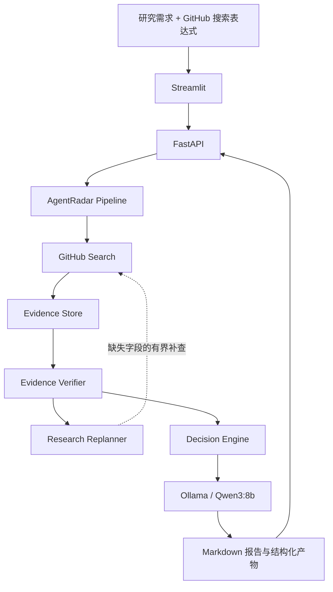

# AgentRadar

**Evidence-Driven Open-Source Technology Research Agent**

AgentRadar 是一个面向开源技术调研与项目初筛的本地 AI Research Agent。它将 GitHub 仓库检索、证据追踪、规则核验、可解释评分与本地大模型报告生成连接为研究流水线，辅助开发者比较候选项目、识别信息缺口并追踪分析依据。

项目基于 [GPT Researcher](https://github.com/assafelovic/gpt-researcher) 扩展，实现了面向 GitHub 技术研究的独立 Pipeline 和 FastAPI / Streamlit 工作台。

> **项目状态：Local MVP。** 当前用于 GitHub 仓库的元数据初筛与辅助研究，不代表已验证候选项目的实际性能、部署能力或全部功能兼容性。

## 核心功能

| 功能 | 实现方式 | 结果 |
|---|---|---|
| GitHub 项目发现 | GitHub REST API、用户指定搜索表达式 | 候选仓库与元数据 |
| 证据追踪 | Evidence Store、内容快照、来源 URL、SHA-256 | 可追溯证据 |
| 规则核验 | Evidence Verifier | `supported` / `contradicted` / `insufficient` |
| 缺失信息补查 | Research Replanner | 有次数限制的补查记录 |
| 候选项目初筛 | Decision Engine | 硬约束与元数据评分 |
| 本地报告生成 | Ollama + Qwen3:8b | Markdown 研究报告 |
| Web 研究工作台 | FastAPI + Streamlit | 任务、候选、证据、报告 |

系统区分原始证据、待核验主张（Claim）与模型生成的分析文字。规则核验主要处理可结构化判断的元数据事实，而不是通用的自然语言事实核验。

## 系统架构



### 研究流程

1. 输入技术需求、GitHub 搜索表达式和候选数量。
2. 获取仓库语言、Stars、许可证和更新时间等元数据。
3. 保存证据快照、来源、采集时间及 SHA-256，并关联 Claim。
4. 运行结构化规则核验，对明确缺失字段执行有限补查。
5. 根据硬约束筛选候选，再执行可解释的元数据评分。
6. 使用本地 Qwen3 整理差异、风险和待验证事项，生成报告。

### 候选评分

| 维度 | 最高分 | 依据 |
|---|---:|---|
| 维护活跃度 | 50 | 仓库近期更新情况 |
| 社区关注度 | 30 | Stars 等元数据 |
| 许可证字段完整性 | 20 | 许可证信息可获取性 |
| **总分** | **100** | 用于初筛与排序 |

主要语言及归档状态等条件可作为硬约束。**评分不等同于代码质量、实际性能、许可证兼容性或生产部署结论。**

## 快速开始

### 环境要求

- Python 虚拟环境；下方示例使用 Windows PowerShell
- Ollama 与 `qwen3:8b`
- 可访问 GitHub REST API 的网络
- 项目 Python 依赖、FastAPI、Uvicorn 和 Streamlit

### 1. 获取代码并安装依赖

```powershell
git clone -b feat/agentradar-v0.1 https://github.com/yanzz66/agentradar.git
cd agentradar

py -3 -m venv .venv
.\.venv\Scripts\python.exe -m pip install -r requirements.txt
```

如果当前依赖环境尚未包含 Web 组件：

```powershell
.\.venv\Scripts\python.exe -m pip install fastapi uvicorn streamlit
```

此仓库保留 GPT Researcher 上游依赖。实际兼容性和补充依赖以当前环境及运行检查为准。

### 2. 准备本地模型与配置

```powershell
ollama list
ollama pull qwen3:8b
```

如果 Ollama 尚未运行，在单独终端执行 `ollama serve`；如果已在后台运行，请勿重复启动。

本地 `.env` 可按环境需要配置模型服务地址与 GitHub 访问令牌，例如：

```dotenv
OLLAMA_BASE_URL=http://127.0.0.1:11434
GITHUB_TOKEN=replace_with_your_token
```

具体生效的环境变量以项目源代码为准。不要提交包含真实令牌的 `.env`。

### 3. 启动服务

**终端 A — FastAPI**

```powershell
.\.venv\Scripts\python.exe -m uvicorn gpt_researcher.api.app:app --host 127.0.0.1 --port 8000
```

**终端 B — Streamlit**

```powershell
.\.venv\Scripts\python.exe -m streamlit run frontend_streamlit/app.py
```

| 服务 | 地址 |
|---|---|
| 研究工作台 | http://localhost:8501 |
| API 文档 | http://127.0.0.1:8000/docs |
| Ollama | http://127.0.0.1:11434 |

## 使用示例

**研究目标：** 寻找适合基于 Python 开发 Browser Agent 的开源项目，比较本地部署、二次开发和浏览器自动化相关能力。

**GitHub 搜索表达式：**

```text
browser agent language:Python archived:false
```

选择候选数量（例如 `5`）后启动研究任务。任务完成后，可在 Streamlit 查看仓库对比、元数据评分、证据与 Claim、完整研究报告，并下载 Markdown。

搜索结果会随 GitHub 数据变化。MCP 支持、具体部署方式等能力声明仍需结合官方文档、源码或实际测试核实。

参见 [功能演示与验收指南](agentradar_docs/AgentRadar_DEMO.md)。

## 核心代码

| 路径 | 职责 |
|---|---|
| `gpt_researcher/actions/agentradar_pipeline.py` | 研究主流程 |
| `gpt_researcher/retrievers/github/github_search.py` | GitHub 仓库检索 |
| `gpt_researcher/actions/evidence_store.py` | 证据快照与哈希 |
| `gpt_researcher/actions/evidence_verifier.py` | 规则核验 |
| `gpt_researcher/actions/replanner.py` | 有界补查 |
| `gpt_researcher/actions/decision_engine.py` | 元数据筛选和评分 |
| `gpt_researcher/actions/local_report_writer.py` | 本地 Qwen3 报告生成 |
| `gpt_researcher/actions/source_router.py` | 独立来源路由扩展 |
| `gpt_researcher/api/app.py` | HTTP API |
| `frontend_streamlit/app.py` | 研究工作台 |
| `tests/` | 模块测试 |
| `scripts/eval_agentradar.py` | 结构一致性及耗时评估 |

`Source Router` 的存在不表示多源检索已经在主 UI 完成端到端验证。

## API 与测试

| 方法 | 路径 | 用途 |
|---|---|---|
| `GET` | `/api/health` | 服务健康检查 |
| `POST` | `/api/research` | 创建研究任务 |
| `GET` | `/api/research/{task_id}` | 查询任务状态与结果 |
| `GET` | `/api/research/{task_id}/candidates` | 获取候选 |
| `GET` | `/api/research/{task_id}/evidence` | 获取证据 |
| `GET` | `/api/research/{task_id}/report` | 获取报告 |

以运行中的 `/docs` 为实际接口定义。

部分模块测试命令：

```powershell
.\.venv\Scripts\python.exe -m unittest discover -s tests -p "test_evidence_verifier.py" -v
.\.venv\Scripts\python.exe -m unittest discover -s tests -p "test_decision_engine.py" -v
.\.venv\Scripts\python.exe -m unittest discover -s tests -p "test_agentradar_pipeline.py" -v
```

本地结构评估：

```powershell
.\.venv\Scripts\python.exe -m scripts.eval_agentradar --new
```

评估结果默认保存在 `output/agentradar/evaluation/`。证据哈希、引用有效性、核验状态和覆盖情况等结构指标**不等于**事实准确率或幻觉率。

## 当前限制

- 主研究界面以 GitHub 专项流水线为主，多源研究链路尚未完成全面端到端验证。
- Evidence Verifier 处理部分结构化事实，不具备通用语义事实核验能力。
- 部分补查数据尚未完整回流至评分输入。
- 元数据评分不能替代源码审查和部署测试。
- 模型生成的解释性结论仍需人工复核。
- 任务状态主要保存在单进程内存，尚未实现完整的跨进程任务恢复。
- 尚未实现生产级认证、监控和任务调度。

## 开源基础与扩展范围

AgentRadar 基于 **GPT Researcher** 进行开发，扩展了 GitHub 专项研究流水线、Evidence Store、规则核验、有界补查、候选评分、本地 Qwen3 报告以及 FastAPI / Streamlit 工作台。

原项目已有的通用研究能力及其他上游组件不属于 AgentRadar 的新增实现。仓库保留上游 Git 历史、许可证和版权声明。

- [GPT Researcher 上游项目](https://github.com/assafelovic/gpt-researcher)
- [上游 README 归档](GPT_RESEARCHER_UPSTREAM.md)
- [LICENSE](LICENSE)
- [AgentRadar 详细技术文档](agentradar_docs/AgentRadar_README.md)
