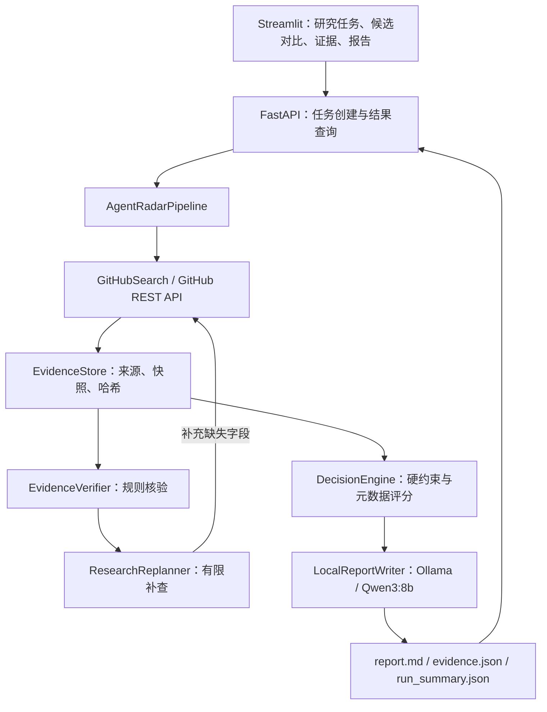

# AgentRadar — 基于证据的开源技术情报与选型 Agent

AgentRadar 是基于 [GPT Researcher](https://github.com/assafelovic/gpt-researcher) 扩展的本地开源技术研究工具。系统从 GitHub 获取候选仓库元数据，保留可追溯证据，执行规则核验与有限补查，使用可解释的元数据规则完成初筛，再通过 **Ollama + Qwen3:8b** 生成初步分析报告，并由 FastAPI / Streamlit 提供交互界面。

**当前定位：本地 MVP，适用于 GitHub 元数据初筛和后续人工技术评估，不是已经验证全部功能兼容性与生产适用性的自动选型系统。**

## 1. 核心功能

- **GitHub 候选检索**：根据指定搜索表达式获取仓库信息。
- **证据管理**：关联 Evidence 与 Claim，保存内容快照、来源、采集时间和 SHA-256。
- **规则核验**：将可结构化验证的主张标记为 `supported`、`contradicted` 或 `insufficient`。
- **有限补查**：对明确缺失的部分元数据执行有次数限制的补充检索。
- **候选初筛**：执行硬约束过滤和可解释的元数据评分。
- **本地报告**：调用 Qwen3:8b 生成包含风险和待验证事项的研究报告。
- **交互界面**：通过 FastAPI 与 Streamlit 展示任务、候选、证据及报告。

## 2. 系统架构



主界面使用独立的 GitHub 研究 Pipeline。项目同时包含 GPT Researcher 自定义 Retriever 接入与任务级 Source Router；**Tavily + GitHub 多源研究尚未纳入已完成端到端验证的主 UI 链路**。

## 3. 扩展模块

| 模块 | 路径 | 功能 |
|---|---|---|
| GitHub Retriever | `gpt_researcher/retrievers/github/github_search.py` | 采集仓库元数据 |
| Source Router | `gpt_researcher/actions/source_router.py` | 任务级数据源选择；非当前主 UI 必经路径 |
| Evidence Store | `gpt_researcher/actions/evidence_store.py` | 快照、SHA-256、来源、采集时间、Claim |
| Evidence Verifier | `gpt_researcher/actions/evidence_verifier.py` | 结构化规则核验 |
| Research Replanner | `gpt_researcher/actions/replanner.py` | 对元数据缺口执行有界补查 |
| Decision Engine | `gpt_researcher/actions/decision_engine.py` | 硬约束与可解释评分 |
| Local Report Writer | `gpt_researcher/actions/local_report_writer.py` | 本地 Qwen3:8b 报告生成 |
| Pipeline | `gpt_researcher/actions/agentradar_pipeline.py` | 研究任务编排与产物输出 |
| FastAPI | `gpt_researcher/api/app.py` | 任务创建及状态查询 |
| Streamlit | `frontend_streamlit/app.py` | 研究工作台 |

### 候选评分口径

| 评分维度 | 最高分 |
|---|---:|
| 维护活跃度 | 50 |
| 社区关注度（Stars 等） | 30 |
| 许可证字段完整性 | 20 |
| **合计** | **100** |

主要语言、归档状态等字段还可用于硬约束筛选。分数仅反映当前的元数据初筛规则，**不代表项目性能、架构质量或许可证兼容性结论**。

## 4. 本地运行

### 环境

- Python 与项目虚拟环境；
- Ollama，已准备 `qwen3:8b`；
- 能访问 GitHub REST API 的网络；
- FastAPI、Streamlit 及项目所需 Python 依赖。

主研究 Pipeline 使用本地 Qwen3，不需要 OpenAI API Key。实际运行需要的配置以环境文件及各模块配置为准。

### 启动（Windows PowerShell）

在本地项目根目录启动服务：

```powershell
# 终端 1：启动 Ollama（如果尚未运行）
ollama serve

# 终端 2：检查模型服务
Invoke-RestMethod http://127.0.0.1:11434/api/tags
ollama list

# 终端 2：启动 AgentRadar FastAPI
.\.venv\Scripts\python.exe -m uvicorn gpt_researcher.api.app:app --host 127.0.0.1 --port 8000

# 终端 3：启动 Streamlit
.\.venv\Scripts\python.exe -m streamlit run frontend_streamlit/app.py
```

打开 `http://localhost:8501` 访问工作台；API 文档位于 `http://127.0.0.1:8000/docs`。

本地 `.env` 可按需提供 `OLLAMA_BASE_URL=http://127.0.0.1:11434` 及 `GITHUB_TOKEN`。仓库不应包含真实密钥、未脱敏研究输出或本机虚拟环境。

## 5. HTTP API

| 方法 | 接口 | 用途 |
|---|---|---|
| GET | `/api/health` | 服务存活检查 |
| POST | `/api/research` | 创建研究任务 |
| GET | `/api/research/{task_id}` | 查询任务状态和摘要 |
| GET | `/api/research/{task_id}/candidates` | 候选项目及评分 |
| GET | `/api/research/{task_id}/evidence` | 证据和 Claim |
| GET | `/api/research/{task_id}/report` | Markdown 报告 |

任务状态目前存储在单进程内存中。FastAPI 重启后，原任务 ID 无法用于恢复尚未持久化的运行状态。

## 6. 测试与评估

项目提供 Evidence Verifier、Replanner、Decision Engine、Local Report Writer 和 Pipeline 等模块的单元测试：

```powershell
.\.venv\Scripts\python.exe -m unittest discover -s tests -p "test_evidence_verifier.py" -v
.\.venv\Scripts\python.exe -m unittest discover -s tests -p "test_replanner.py" -v
.\.venv\Scripts\python.exe -m unittest discover -s tests -p "test_decision_engine.py" -v
.\.venv\Scripts\python.exe -m unittest discover -s tests -p "test_local_report_writer.py" -v
.\.venv\Scripts\python.exe -m unittest discover -s tests -p "test_agentradar_pipeline.py" -v

# 创建新任务并生成结构一致性与耗时评估结果
.\.venv\Scripts\python.exe -m scripts.eval_agentradar --new
```

本地评估产物默认位于 `output/agentradar/evaluation/`，包含任务耗时与结构指标。已经开展的结构检查覆盖证据哈希、Claim 引用、核验状态、候选证据覆盖及报告引用覆盖；**这些指标衡量结构一致性，不等同于事实准确率或幻觉率**。人工报告质量评估尚未完成。

## 7. 当前限制

- 规则核验适用于部分结构化主张，不是通用语义事实核验。
- Stars、最近推送时间和许可证字段用于初筛，无法直接证明维护质量、MCP 支持或商业使用适配性。
- 部分补查证据尚未完整回流至 Decision Engine 的评分输入。
- Tavily / Source Router 多源链路尚未完成主 UI 端到端验证。
- 模型生成的自然语言结论尚未进行逐句自动事实核验。
- 由于快照可能包含动态采集时间，部分 Evidence ID 在不同运行之间不保证相同。
- 尚未提供跨进程任务恢复、生产级认证和任务调度。

## 8. 开源基础与扩展范围

AgentRadar 在 **GPT Researcher** 代码基础上新增 GitHub 专项研究流水线、证据管理、规则核验、有界补查、元数据评分、本地报告生成以及 FastAPI / Streamlit 工作台。原项目已有的研究规划、多 Agent 及其他通用能力属于上游实现。

仓库保留上游的许可证与版权声明。上游地址：[assafelovic/gpt-researcher](https://github.com/assafelovic/gpt-researcher)。

功能操作流程参见 [功能演示与验收指南](AgentRadar_DEMO.md)。
